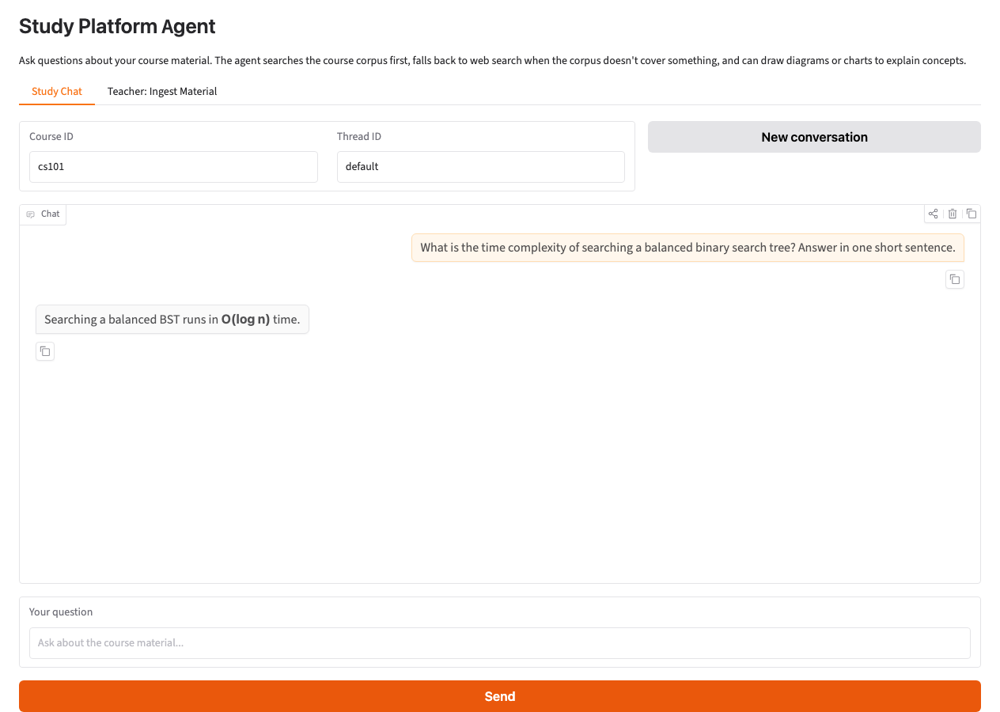
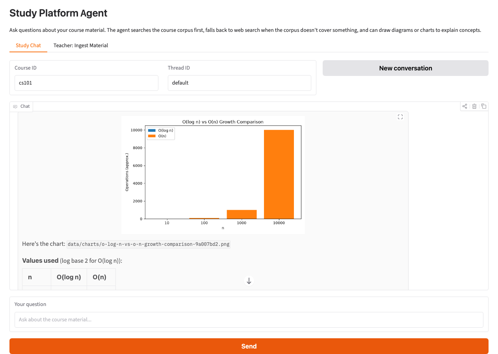
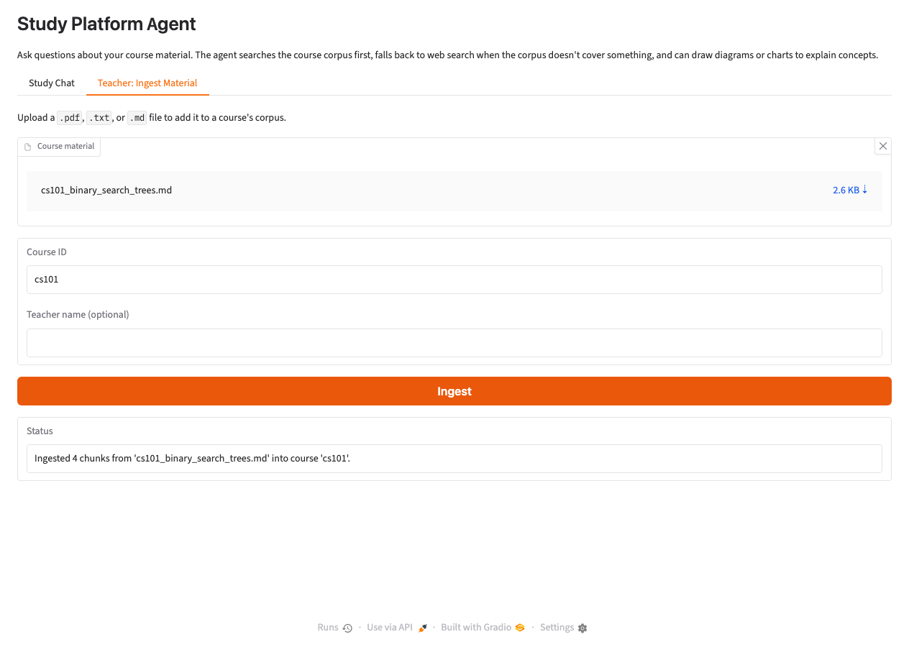
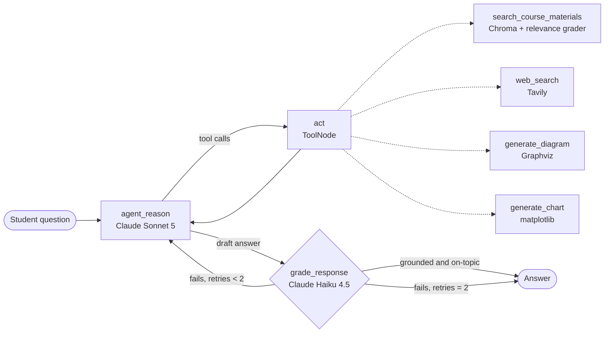

# Corrective RAG Study Agent

**A LangGraph tutoring agent that answers from a teacher's own course material, falls back to the web only when the material runs out, checks its own answers for hallucinations before the student sees them, and draws charts and diagrams when a picture explains better than text.**


| Study chat | Chart generated by the agent | Teacher ingestion |
|---|---|---|
|  |  |  |

## Results

Measured with an end-to-end eval ([`eval/`](eval/)): 20 student questions run through the real graph (real Claude calls, real web search, real chart rendering), with deterministic checks on which tools were called and what the final answer says.

| Metric | Baseline | After fixes |
|---|---|---|
| **Cases passing all checks** | 16/20 | **18/20** |
| Answers from course material, no web search (`in_course`) | 6/8 | **7/8** |
| Falls back to the web when the material doesn't cover it (`web_fallback`) | 4/4 | 3/4 |
| Declines off-topic questions without leaking the answer (`off_topic`) | 2/4 | **4/4** |
| Renders a chart or diagram when asked (`visual`) | 4/4 | 4/4 |
| Cost per question (agent + all graders) | $0.048 | **$0.043** |
| Cost of an off-topic question | $0.032 | **$0.012** (-62%) |
| Latency, median / p95 | 15.8 s / 42.8 s | 18.5 s / 38.9 s |

Raw per-case results (answers, tool calls, token usage) are in [`eval/results/`](eval/results/).

### What the eval caught

The first run surfaced four problems no unit test would have found:

1. **A tool-name mismatch.** The system prompt told the model to use `web_search`, but `TavilySearch` registers itself as `tavily_search`. The model coped by guessing, but the prompt was describing a tool that didn't exist. Fixed by pinning the name.
2. **Answering from memory instead of the course.** For "easy" questions (*"what's the complexity of searching a balanced BST?"*) the agent skipped retrieval and answered from its own knowledge, and the groundedness grader let it through. For a tutor this is a real bug: the teacher's material is the source of truth. Fixed in the system prompt; the cost is the small latency increase above.
3. **The self-correction loop made off-topic leaks worse.** When the agent correctly declined *"what's the capital of Australia?"*, the answer grader scored the refusal as "doesn't address the question", and the critique told the agent to *search again*. It then searched the web and answered "Canberra" on the second try. Fixed by teaching the answer grader that a scoped refusal is a valid answer. Off-topic questions now end after a single agent turn instead of two revision rounds.
4. **Two bugs in the eval itself** (the tool name, and a regex that rejected `2 · log(n)`). The baseline was re-scored offline with `--rescore`, so the numbers above compare like with like and the original failures stay in the result file.

The two remaining failures are judgment calls, left unfixed on purpose. In one, the agent put the explanation inside a generated diagram instead of the text. In the other, it asked the student a clarifying question before searching the web, which its prompt allows for broad questions.

## How it works



- **ReAct loop.** `agent_reason` and `act` loop until the model stops calling tools. Four tools: course search, web search, diagram and chart.
- **Corrective RAG.** `search_course_materials` retrieves from a per-course Chroma collection, then a Haiku grader drops irrelevant chunks before the agent sees them. That way the agent can tell "the course doesn't cover this" apart from "I searched badly", and knows when to fall back to the web.
- **Reflexion-style self-correction.** Before an answer is returned, `grade_response` checks it for groundedness (against tool results *and* what the student said earlier) and for relevance. A failing draft goes back to the agent with a critique, capped at 2 retries. Routing uses LangGraph's `Command` API: the node chooses its own next step.
- **Course isolation.** `course_id` reaches the tools through `InjectedState`, never as a model argument, so the model can't query another course's material.
- **Persistence.** A `SqliteSaver` checkpointer keyed by `thread_id` lets conversations survive restarts and be shared between the CLI and the web UI.
- **Robustness.** Tool exceptions become error messages instead of crashing the graph. Dangling `tool_use` blocks from interrupted runs are patched before every call, so a killed process can't corrupt a thread forever. Embedding calls are serialized, because parallel tool calls into the shared model segfaulted.

## Quickstart

Requires [`uv`](https://docs.astral.sh/uv/), Python 3.12 and [Graphviz](https://graphviz.org/) (`brew install graphviz` / `apt install graphviz`).

```bash
uv sync
cp .env.example .env          # ANTHROPIC_API_KEY, TAVILY (+ optional LangSmith)

# Ingest the demo course material
uv run python -m ingestion.ingest --course cs101 \
    --file data/sample_docs/cs101_binary_search_trees.md --teacher "Demo Teacher"

uv run python -m ui.app                       # web UI on http://127.0.0.1:7860
uv run python main.py --course cs101          # or the CLI
```

To try the four behaviours in the UI:

| Ask | Expected behaviour |
|---|---|
| *What is the time complexity of searching a balanced BST?* | Answers from the course material |
| *Who invented the AVL tree?* | Course search finds nothing relevant, so it falls back to web search |
| *Plot O(log n) vs O(n) for n = 10, 100, 1000* | Renders a chart inline |
| *What's the capital of Australia?* | Declines as out of scope |

The main model can be swapped to compare cost and quality (the graders always use Haiku):

```bash
STUDY_AGENT_MODEL=claude-haiku-4-5 uv run python -m ui.app
```

## Evaluation and tests

```bash
uv run python -m eval.run_eval                         # 20 cases, ~US$0.90, ~7 min
uv run python -m eval.run_eval --only off-capital      # one case
uv run python -m eval.run_eval --rescore eval/results/<run>.json   # re-check a saved run, no API calls

uv run pytest tests/test_graph.py                      # structural graph tests, no API calls
uv run pytest tests/test_chains.py                     # grader chains against real Claude calls
```

The eval ingests the sample material into an isolated `eval-cs101` collection, so it never touches real course data. Cases live in [`eval/cases.yaml`](eval/cases.yaml); each one states which tools must or must not be called and which regexes the answer must or must not contain.

## Project structure

```
graph/
  graph.py               StateGraph wiring
  state.py               AgentState (messages + course_id, retry_count, current_question)
  persistence.py         SqliteSaver checkpointer
  nodes/agent.py         agent_reason: system prompt, tool binding, dangling tool-call repair
  nodes/grade_response.py  self-correction node (Command-based routing)
  tools/                 course_search (CRAG), web_search (Tavily), visualize (Graphviz / matplotlib)
  chains/                retrieval, hallucination and answer graders (structured output)
ingestion/               per-course Chroma collections + teacher ingestion CLI (.pdf/.txt/.md)
ui/app.py                Gradio app: study chat + teacher ingestion tabs
eval/                    end-to-end eval: cases, runner, saved results
tests/                   structural graph tests + live grader tests
```

## Design notes and limitations

- **Two models, two jobs.** Sonnet runs the multi-step tool orchestration; the cheap, frequent grading calls (one per retrieved chunk, two per draft) run on Haiku.
- **Local embeddings.** `all-MiniLM-L6-v2` runs on CPU, so embedding needs no API key.
- **Small eval.** 20 cases over one short document is enough to catch regressions and systematic bugs like the ones above, not to estimate rates precisely: one case is 5 points. The 18/20 is measured on the same cases that guided the fixes, so it is optimistic by construction.
- **Lenient groundedness grader.** In the final run, 20/20 first drafts passed self-correction. The eval found ungrounded answers the grader accepted, so treat the grader as a safety net, not a guarantee.
- **Demo-grade UI.** Single process, no auth. The graph is UI-agnostic, so a production frontend (FastAPI + SPA) could sit on top without changing it.
- **Static diagrams.** Diagrams are rendered server-side to PNG. Mermaid inside Gradio's chat never rendered for messages streamed mid-turn, and the model was unreliable at copying multi-line diagram source verbatim.

Built with Claude through `langchain-anthropic`, traced with LangSmith during development.
